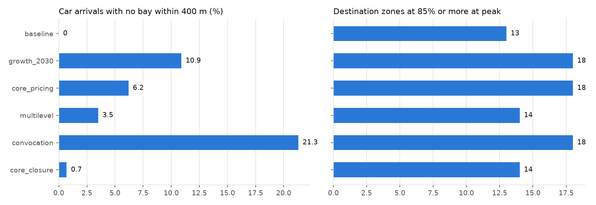
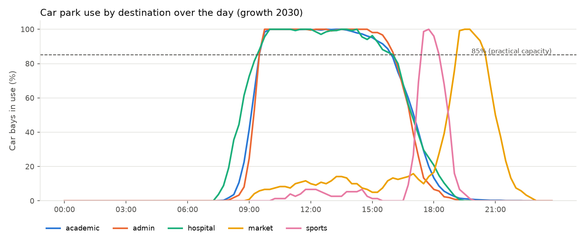
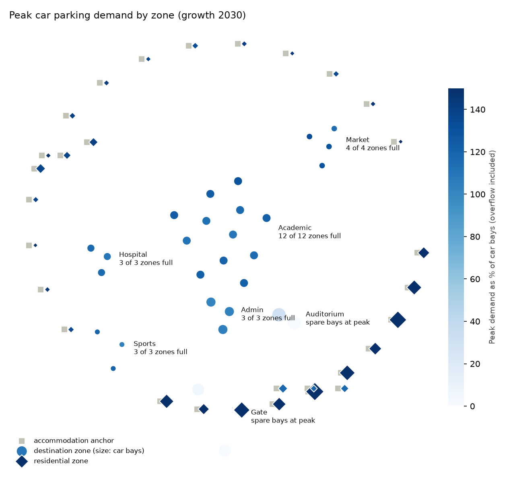

# Parking Twin

[](https://github.com/S-blip-hub/parking-twin/actions/workflows/ci.yml)

A scenario model of campus parking. It follows every resident car and two-wheeler from **30 accommodation anchors** to **60 parking zones** through a weekday in 5-minute steps, and reports zone occupancy, unmet demand and walking distance for each planning scenario.

The simulation engine is written in Go (standard library only) so a full scenario set runs in well under a second; the figures are drawn in Python.

This repository is a portfolio implementation of the parking work I did at SRIC, IIT Kharagpur, which combined GIS layers with hall and parking-zone datasets. Those datasets are not included; the anchors and zones here are schematic and the model covers cars and two-wheelers.



**Stack:** Go · Python (pandas, Matplotlib) · Make

## Model

| Part | What it contains |
|---|---|
| Accommodation anchors | 14 student halls, 10 staff-quarter clusters, 3 guest houses and 3 scholars' flats, each with residents and car and two-wheeler ownership rates |
| Parking zones | 30 residential zones (one per anchor) and 30 destination zones in the academic core, administration, hospital, market, sports, auditorium and gate clusters, each with separate car and two-wheeler bays |
| Demand | Purpose-specific outings (work and study, guest visits, evening market and sports) with arrival-time and dwell-time distributions, plus day visitors and optional events |
| Parking choice | A vehicle takes the nearest zone with a free bay of its type within the walking limit (400 m for cars, 250 m for two-wheelers). Otherwise the arrival is unmet and counted as overflow parking |
| Outputs | Zone occupancy every 15 minutes, a JSON summary per scenario and a comparison table |

## Scenario controls

Scenarios live in [`scenarios/scenarios.json`](scenarios/scenarios.json). Every field is optional except the name.

| Control | Effect |
|---|---|
| `car_ownership_multiplier`, `two_wheeler_ownership_multiplier` | Scale vehicle ownership at every anchor |
| `visitor_cars` | Day visitors entering through the gates |
| `max_walk_car_m`, `max_walk_two_wheeler_m` | Furthest a driver will walk from a bay |
| `core_car_shift` | Share of resident car trips to the academic core that switch mode (for example under paid parking) |
| `closed_zones` | Zones taken out of use |
| `extra_car_bays` | Bays added to named zones |
| `events` | One-off surges with a destination cluster, vehicle counts, arrival window and dwell time |
| `seed` | Random seed, for repeatable runs |

## Results

| Scenario | Resident cars | Car arrivals with no bay | Mean car walk | Zones at 85%+ at peak | Max overnight overflow at homes |
|---|---|---|---|---|---|
| baseline | 1,105 | 0.0% | 96 m | 13 | 82 cars |
| growth_2030 (+40% cars) | 1,545 | 10.9% | 122 m | 18 | 512 cars |
| core_pricing (growth, 30% core car shift) | 1,545 | 6.2% | 129 m | 18 | 512 cars |
| multilevel (growth, +300 core bays) | 1,545 | 3.5% | 92 m | 14 | 512 cars |
| convocation (+900 guest cars) | 1,105 | 21.3% | 134 m | 18 | 82 cars |
| core_closure (2 core car parks shut) | 1,105 | 0.7% | 114 m | 14 | 82 cars |

What the scenarios show:

- **Today the system works, but with little slack.** No arrival goes unmet, yet the academic core, administration and sports car parks all pass 85% at their peaks (11:05, 12:55 and 17:50).
- **Growth breaks the core first.** With 40% more cars, one car arrival in nine finds no bay within 400 m, and every academic-core zone is full by late morning.
- **Supply and pricing work together.** A 300-bay multilevel car park cuts unmet arrivals from 10.9% to 3.5%. Paid core parking alone gets to 6.2%. Combining a smaller car park with pricing is worth testing next.
- **Homes overflow before destinations.** In the growth case, residential zones need about 500 more car bays overnight. Staff quarters already run short by about 80 cars today.
- **Events need their own plan.** A convocation fills the auditorium car parks by 10:00 and pushes 415 cars into overflow there, spilling into the admin and academic zones.




## Quick start

Requires Go 1.22+ and Python 3.10+.

```bash
make test        # go vet and unit tests
make run         # run every scenario, outputs in outputs/
make plots       # figures in docs/figures/ (pip install -r requirements.txt)
make all         # all of the above
```

Run one scenario or another scenario file:

```bash
go run ./cmd/parkingtwin -only convocation
go run ./cmd/parkingtwin -scenarios my_scenarios.json -out runs/
```

## Project structure

```
cmd/parkingtwin/     command-line entry point
internal/campus/     anchors, clusters and zones
internal/sim/        scenario controls, simulation, peaks and summaries (with tests)
internal/report/     CSV and JSON writers
scenarios/           scenario definitions
analysis/plots.py    figures
```

## Limitations

- The layout, ownership rates and trip propensities are illustrative and not calibrated against parking counts.
- Drivers do not re-route after failing to find a bay, and there is no pricing elasticity beyond the single `core_car_shift` control.
- One typical weekday is simulated. Weekends and seasonal peaks need their own demand profiles.

## Author

Shrey Singh, B.Arch, Department of Architecture and Regional Planning, IIT Kharagpur.

## License

MIT
